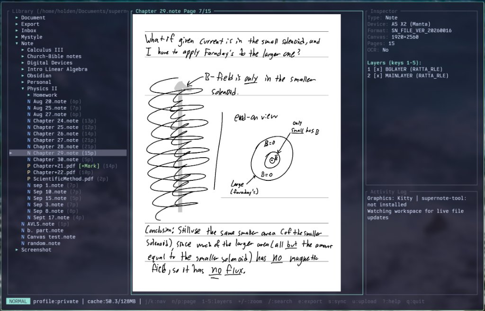

# `sn-tui` — Lean Terminal-Native Supernote Viewer, Exporter & Sync Manager

> [!NOTE]
> **Disclosure:** In its current state, essentially all software in this repository was generated by Google Antigravity; only the idea, architecture, and high-level decisions were made by [holdenstill](https://github.com/holdenstill).

A fast, zero-GUI-toolkit Terminal User Interface (TUI) and headless CLI written in Rust for viewing, exporting, and syncing Ratta Supernote `.note` notebooks and annotated `.pdf` + `.pdf.mark` documents on Linux (built and tested for Artix Linux / Wayland / MangoWC).



## Highlights
- **Zero GUI Bloat / Ultra-Lean Runtime:** No GTK, Qt, Electron, WebKit, X11, `tokio`, or `reqwest`. Uses `ratatui` + `ratatui-image` (auto-detecting Kitty, Sixel, iTerm2, or Unicode half-block fallbacks), OS threads, bounded `rayon` workers, and blocking `ureq` (`rustls`).
- **Pure-Rust `.note` & `.mark` Engine:** Native parsing and `RATTA_RLE` (X & X2 anti-aliased) + `PNG` rendering for A5X, A6X, A6X2 (Nomad), and A5X2 (Manta), including landscape pages, selective layer toggling (`1`–`5`), and native `RECOGNTEXT` real-time recognition text extraction (no Python needed for `.txt`/`.md` or `/` OCR search).
- **PDF + `.pdf.mark` Viewing & Lossless Export:**
  - *Viewing:* Single-page on-demand rasterization via `pdftoppm` (`poppler`) alpha-composited with companion `.pdf.mark` annotation strokes.
  - *Exporting:* Pure-Rust `lopdf` stamps transparent `.mark` XObjects onto the original PDF while preserving 100% of original selectable vector text and hyperlinks.
  - *Fast `.note` Raster PDF:* Direct minimal PDF 1.7 writer using `/DeviceGray` + `flate2` zlib streams.
  - *Optional `supernote-tool` Bridge:* Automatically detects `supernote-tool` or `uvx` on `PATH` for Vector PDF (`--pdf-type vector`) and SVG exports.
- **Safe Native Cloud & Private Cloud Sync:**
  - Native support for **Official Ratta Supernote Private Cloud (Docker)**, **Free Supernote Cloud (`https://cloud.supernote.com`)**, **`allenporter/supernote` Open Private Cloud (`sn_...` Bearer tokens)**, and **Standard WebDAV**.
  - **Pull-only mirror by default** (never deletes or mutates remote notes) + **explicit upload** (`sn-tui upload` or `u` in TUI) for pushing PDFs/templates to your tablet.
  - Built-in `notify` filesystem watcher refreshes the TUI, invalidates caches, and optionally runs auto-exports when local files change.
- **Bounded Resource Usage:** 128 MB LRU disk cache (`~/.cache/sn-tui/pages/`), lazy OCR index (`ocr_index.json`), and a 6-page in-memory prefetch window.

## Installation

### Arch / Artix Linux (AUR)
```bash
# Pre-built release binary (recommended)
yay -S sn-tui-bin
# or build from source via AUR helper
paru -S sn-tui
```

### Universal Shell Installer (Linux & macOS)
```bash
curl -fsSL https://raw.githubusercontent.com/HoldenStill/sn-tui/main/scripts/install.sh | sh
```

### Windows (PowerShell)
```powershell
powershell -c "irm https://raw.githubusercontent.com/HoldenStill/sn-tui/main/scripts/install.ps1 | iex"
```

### Rust / Cargo
```bash
cargo install sn-tui
# Or with fast binary installer:
cargo binstall sn-tui
```

### Build from Source
```bash
git clone https://github.com/HoldenStill/sn-tui.git
cd sn-tui
cargo build --release
install -Dm755 target/release/sn-tui ~/.local/bin/sn-tui
```

### Optional Host Utilities
- `poppler` (`pdftoppm`, `pdfinfo`): required only for viewing `.pdf` + `.pdf.mark` pages inside the TUI.
- `supernote-tool` (`pipx install supernotelib` or `uvx`): optional, only needed for `pdf-vector` and `svg` exports.

## Quick Start

### 1. Initialize Configuration
```bash
sn-tui init-config
```
This creates `~/.config/sn-tui/config.toml` with `0600` permissions. Edit it to configure your sync profile(s):

```toml
workspace_dir = "~/Supernote"
export_dir = "~/Supernote/Exports"
cache_max_mb = 128
pdf_render_dpi = 150
max_workers = 4
default_profile = "private"

[profiles.private]
kind = "private_cloud"
base_url = "https://supernote.local"
account = "you@example.com"
password = "your-password"
remote_root = "/"
verify_tls = true

[profiles.cloud]
kind = "supernote_cloud"
base_url = "https://cloud.supernote.com"
account = "you@example.com"
password = "your-password"
remote_root = "/"

[profiles.open_cloud]
kind = "open_private_cloud"
base_url = "http://127.0.0.1:8000"
token = "sn_your_bearer_token"
remote_root = "/"

[profiles.webdav]
kind = "webdav"
base_url = "https://dav.example.com/Supernote"
account = "username"
password = "password"
remote_root = "/"
```

Environment variables `SN_ACCOUNT`, `SN_PASSWORD`, and `SN_TOKEN` always override config file values. If plaintext credentials are stored in `config.toml` with overly permissive modes, `sn-tui` emits a warning recommending `chmod 600`.

### 2. Interactive TUI
```bash
sn-tui               # opens configured workspace_dir
sn-tui ~/Supernote   # opens a specific directory
```

| Key | Action |
|---|---|
| `j` / `k` or `↓` / `↑` | Move selection down / up in library tree |
| `h` / `l` or `←` / `→` | Collapse / expand directory (or pan when zoomed) |
| `n` / `p` or `J` / `K` | Next / previous page |
| `g` | Jump to page number |
| `1`–`5` | Toggle `.note` layer visibility (`1` toggles `.mark` overlay on PDFs) |
| `+` / `-` / `0` | Zoom in / out / reset zoom |
| `/` | Fuzzy search filenames & cached OCR text |
| `e` | Open Export modal (selected file or workspace directory) |
| `s` | Run pull-sync for active profile |
| `u` | Upload selected local PDF/template to remote folder |
| `r` | Refresh tree & invalidate active page cache |
| `?` | Toggle help overlay |
| `q` / `Ctrl+C` | Quit cleanly |

### 3. Headless CLI Subcommands
```bash
# Inspect metadata & embedded recognition text as JSON
sn-tui inspect ~/Supernote/Note/meeting.note
sn-tui inspect ~/Supernote/Document/paper.pdf

# Export a single file or entire folder hierarchy
sn-tui convert ~/Supernote/Note/meeting.note ./meeting.pdf --format pdf-raster
sn-tui convert ~/Supernote/Document/paper.pdf ./paper_annotated.pdf --format pdf-annotated
sn-tui convert ~/Supernote/Note/ ./exports/ --format md

# Pull-sync (safe read-only mirror) & explicit upload
sn-tui sync --dry-run
sn-tui sync --profile private --auto-export
sn-tui upload ./reading.pdf --dest /Document --profile private
```
